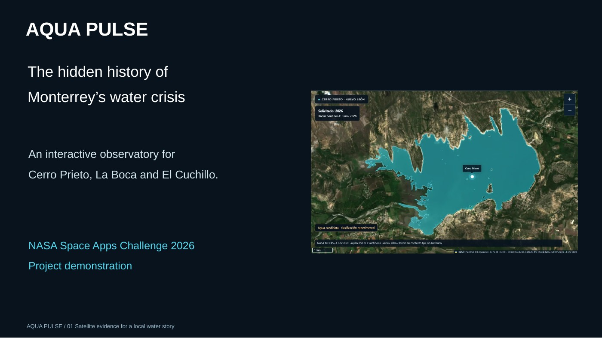
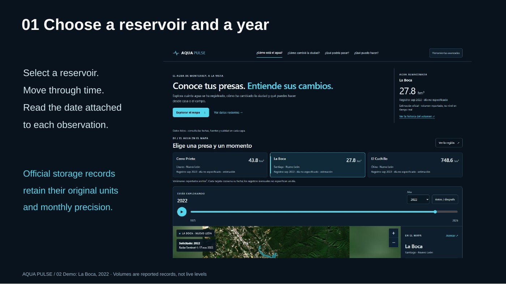
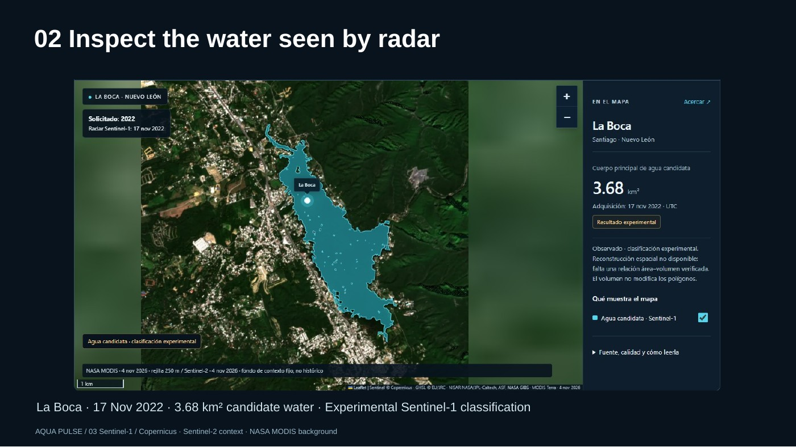
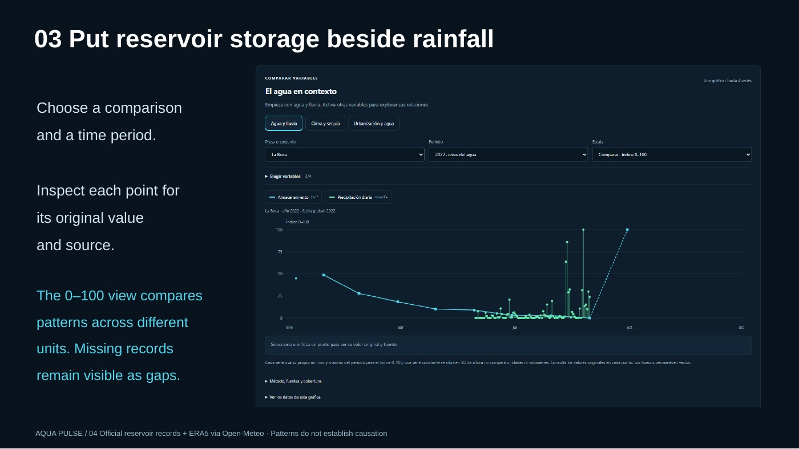
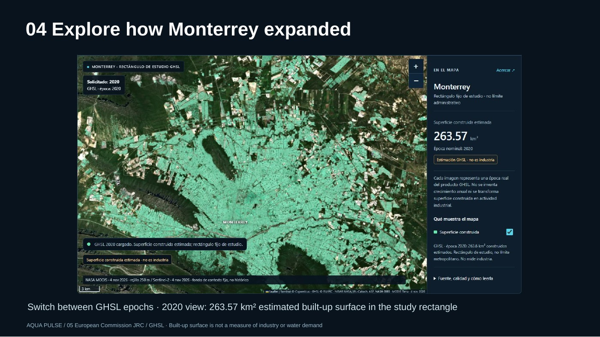
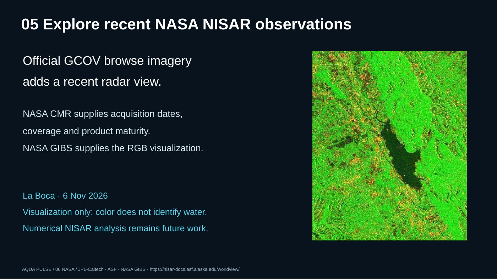
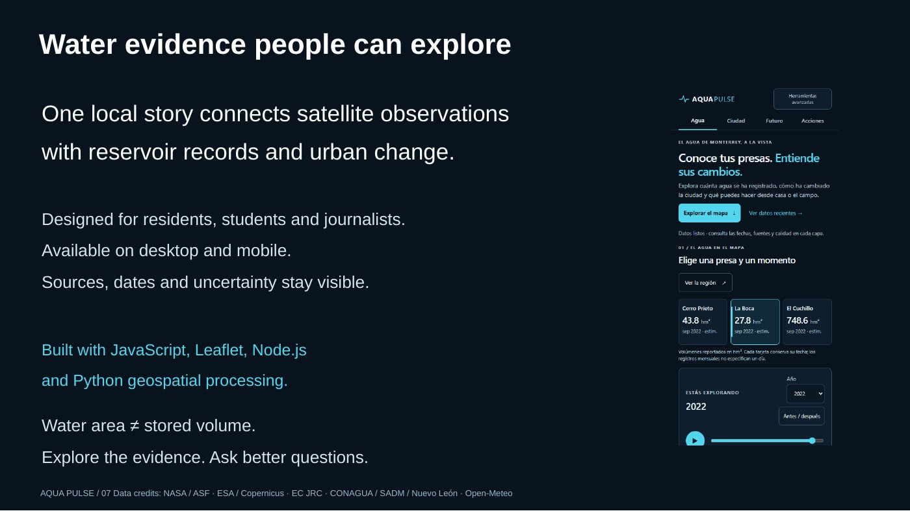

# AQUA PULSE — Project Demo

A seven-slide demonstration for NASA Space Apps Challenge 2026, including the title and introduction.

**[View the 7-slide PDF](AQUA-PULSE-Demo.pdf)** · **[Download the PowerPoint](AQUA-PULSE-Demo.pptx)**

Explore Monterrey’s reservoir history through satellite observations, official storage records, weather and urban growth.

## Slide presentation

## Sources and attribution

Screenshots are from the project’s recorded browser verification on 15 November 2026. They show the implemented application, including its Spanish interface. Slide explanations are in English. The NASA NISAR image is an official GIBS GCOV browse visualization dated 6 November 2026.

- NASA/JPL-Caltech, ASF and NASA GIBS: https://www.earthdata.nasa.gov/data/tools/gibs
- NISAR imagery guide: https://nisar-docs.asf.alaska.edu/worldview/
- NASA CMR: https://cmr.earthdata.nasa.gov/search/
- Contains modified Copernicus Sentinel data (2022 and 2026); ESA/Copernicus, Microsoft Planetary Computer and Element 84.
- European Commission Joint Research Centre: GHSL GHS-BUILT-S R2023A, CC BY 4.0; Global Surface Water v1.5.
- CONAGUA/SMN, SADM and Gobierno de Nuevo León: official reservoir records.
- ERA5 / Copernicus Climate Change Service / ECMWF, delivered through Open-Meteo: https://open-meteo.com/
- Leaflet: https://leafletjs.com/

See [dataset notices](DATA_LICENSES.md). Water extent is an experimental classification and is distinct from stored volume. NISAR is used for catalog evidence and visualization; numerical NISAR water analysis is future work.

This public repository contains demo materials only.
